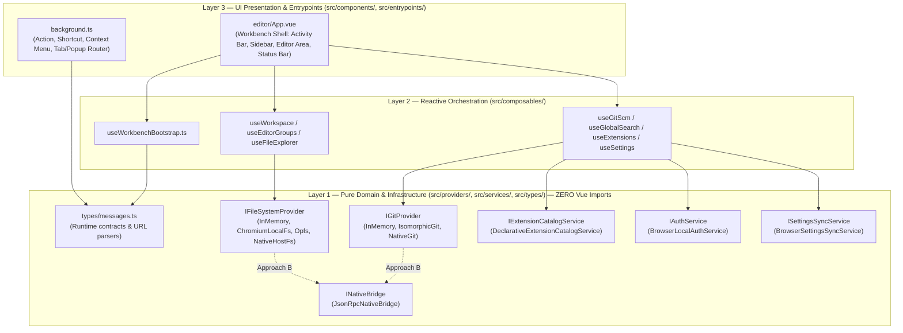
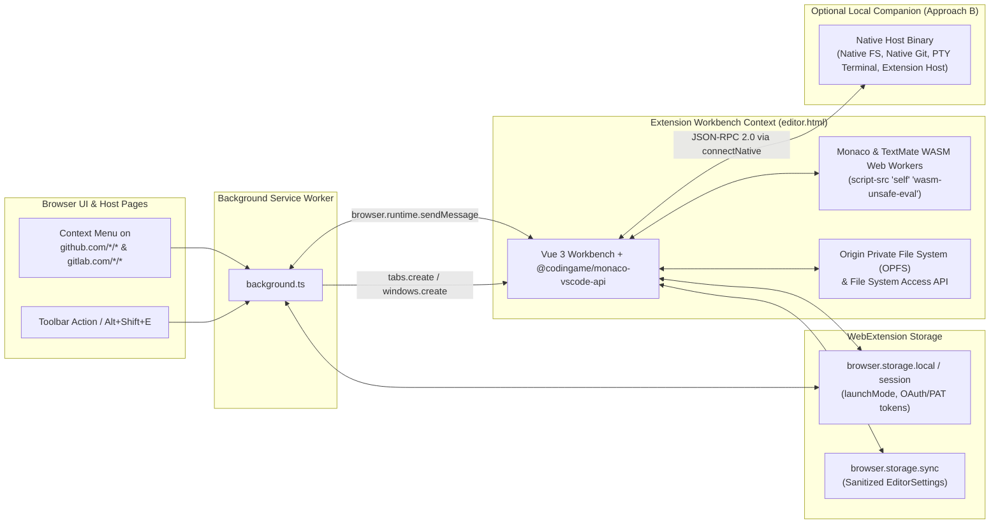
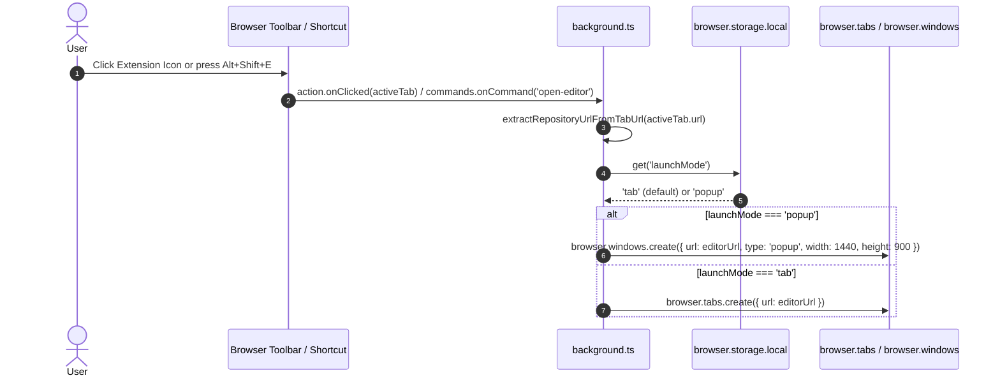
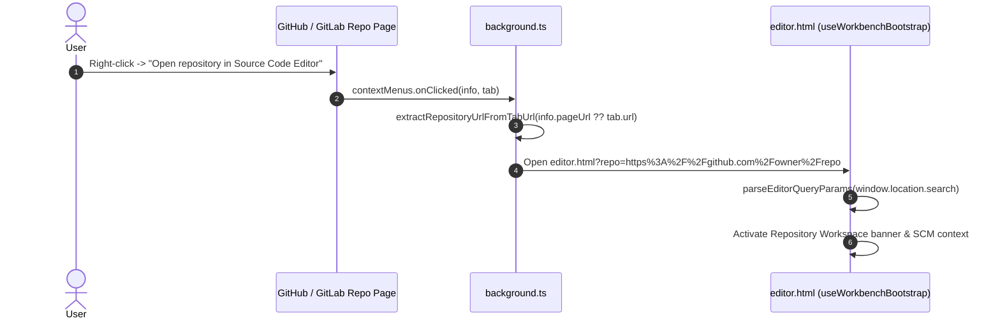
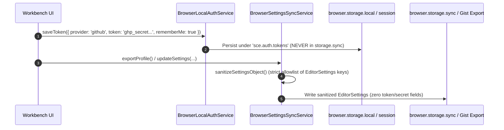
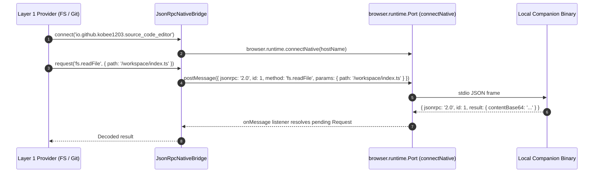

# Architecture & Cross-Context Messaging

This document defines the 3-Layer Clean Architecture, execution contexts, runtime & native messaging contracts, and core workflows of the **Source Code Editor Web Extension** (Manifest V3).

## Table of Contents

1. [Three-Layer Clean Architecture](#three-layer-clean-architecture)
2. [System Architecture & Execution Contexts](#system-architecture--execution-contexts)
3. [Execution Contexts Matrix](#execution-contexts-matrix)
4. [Communication Transports & Contracts](#communication-transports--contracts)
5. [Key Workflows & Sequence Diagrams](#key-workflows--sequence-diagrams)
   - [Workflow 1: Launching the Workbench (Tab vs Standalone Popup Window)](#workflow-1-launching-the-workbench-tab-vs-standalone-popup-window)
   - [Workflow 2: Opening a GitHub or GitLab Repository via Context Menu or Active Tab](#workflow-2-opening-a-github-or-gitlab-repository-via-context-menu-or-active-tab)
   - [Workflow 3: Settings Sync vs Token Security Boundary](#workflow-3-settings-sync-vs-token-security-boundary)
   - [Workflow 4: Approach B — JSON-RPC 2.0 Native Bridge to Local Companion](#workflow-4-approach-b--json-rpc-20-native-bridge-to-local-companion)

---

## Three-Layer Clean Architecture

All code in `src/` is organized into three concentric layers with strict inward-only dependencies (`Layer 3 -> Layer 2 -> Layer 1`):

---

## System Architecture & Execution Contexts

The extension runs with **zero permanent content scripts** on web pages. It operates across four isolated execution contexts governed by Manifest V3 security rules:

---

## Execution Contexts Matrix

| Context                           | Entry Point                                 | Lifecycle                                                                                          | Privileges & Capabilities                                                                                                                                                                                                                            | Constraints                                                                                                                                                                  |
| :-------------------------------- | :------------------------------------------ | :------------------------------------------------------------------------------------------------- | :--------------------------------------------------------------------------------------------------------------------------------------------------------------------------------------------------------------------------------------------------- | :--------------------------------------------------------------------------------------------------------------------------------------------------------------------------- |
| **Background Service Worker**     | `src/entrypoints/background.ts`             | Event-driven (terminated when idle in MV3)                                                         | Registers declarative context menus on GitHub/GitLab, handles toolbar clicks and `open-editor` command, opens `editor.html` in a tab or popup window, manages `launchMode` in `browser.storage.local`.                                               | No DOM access. Must remain stateless across idle restarts.                                                                                                                   |
| **Workbench Page (Tab or Popup)** | `src/entrypoints/editor/index.html`         | Persistent while the editor tab or standalone popup window is open                                 | Full WebExtension APIs (`storage`, `runtime`), File System Access API (`showDirectoryPicker`), Origin Private File System (`navigator.storage.getDirectory()`), CORS-free `fetch` via `<all_urls>` host permissions, Monaco & TextMate WASM workers. | Governed by MV3 CSP (`script-src 'self' 'wasm-unsafe-eval'; worker-src 'self'; object-src 'self';`). Cannot execute arbitrary remote JS extensions in `standalone-web` mode. |
| **Monaco & TextMate Workers**     | Dedicated Web Workers (`worker-src 'self'`) | Spawned by Workbench                                                                               | High-performance tokenization (`vscode-oniguruma` WASM), language services (TS/JS/CSS/HTML/JSON), and workspace indexing off the main thread.                                                                                                        | No direct DOM or `browser.*` API access.                                                                                                                                     |
| **Local Companion Native Host**   | External OS binary (`INativeBridge`)        | Spawned on demand via `browser.runtime.connectNative` when `nativeMessaging` permission is granted | Direct OS file system I/O on all browsers (including Firefox), native `git` CLI (SSH/GPG/hooks), PTY terminal, and full Node.js VS Code Extension Host.                                                                                              | Optional (`RuntimeMode = 'local-companion'`). Communicates strictly via JSON-RPC 2.0 over stdio.                                                                             |

---

## Communication Transports & Contracts

### 1. Runtime Messages (`src/types/messages.ts`)

| Message Type      | Direction                               | Request Interface                                                                                                 | Response Interface                                                                             | Description                                                                                                |
| :---------------- | :-------------------------------------- | :---------------------------------------------------------------------------------------------------------------- | :--------------------------------------------------------------------------------------------- | :--------------------------------------------------------------------------------------------------------- |
| `OPEN_EDITOR`     | Workbench / UI $\rightarrow$ Background | `OpenEditorRequest` `{ type: 'OPEN_EDITOR', workspaceId?: string, repoUrl?: string, launchMode?: LaunchMode }` | `RuntimeResponse` `{ ok: true, launchMode: LaunchMode, tabId?: number, windowId?: number }` | Opens `editor.html` (with optional `?workspace=` or `?repo=`) in a browser tab or standalone popup window. |
| `OPEN_REPOSITORY` | UI $\rightarrow$ Background             | `OpenRepositoryRequest` `{ type: 'OPEN_REPOSITORY', repoUrl: string, launchMode?: LaunchMode }`                | `RuntimeResponse`                                                                              | Validates a GitHub/GitLab repository URL and launches `editor.html?repo=<encoded>`.                        |
| `GET_LAUNCH_MODE` | Workbench $\rightarrow$ Background      | `GetLaunchModeRequest` `{ type: 'GET_LAUNCH_MODE' }`                                                           | `RuntimeResponse` `{ ok: true, launchMode: LaunchMode }`                                    | Reads the stored `launchMode` (`'tab'` \| `'popup'`) from `browser.storage.local`.                         |
| `SET_LAUNCH_MODE` | Workbench $\rightarrow$ Background      | `SetLaunchModeRequest` `{ type: 'SET_LAUNCH_MODE', launchMode: LaunchMode }`                                   | `RuntimeResponse` `{ ok: true, launchMode: LaunchMode }`                                    | Persists the user's preferred `launchMode` (`'tab'` \| `'popup'`) in `browser.storage.local`.              |

### 2. JSON-RPC 2.0 Native Bridge (`src/services/nativeBridge.ts`)

- **Transport**: `browser.runtime.connectNative(hostName)` (`Port.postMessage` / `Port.onMessage`).
- **Envelope**:
  - Request: `{ jsonrpc: '2.0', id: number | string, method: string, params?: Record<string, unknown> }`
  - Response: `{ jsonrpc: '2.0', id: number | string, result?: unknown, error?: { code: number, message: string, data?: unknown } }`
  - Notification: `{ jsonrpc: '2.0', method: string, params?: Record<string, unknown> }`

---

## Key Workflows & Sequence Diagrams

### Workflow 1: Launching the Workbench (Tab vs Standalone Popup Window)

### Workflow 2: Opening a GitHub or GitLab Repository via Context Menu or Active Tab

### Workflow 3: Settings Sync vs Token Security Boundary

### Workflow 4: Approach B — JSON-RPC 2.0 Native Bridge to Local Companion

