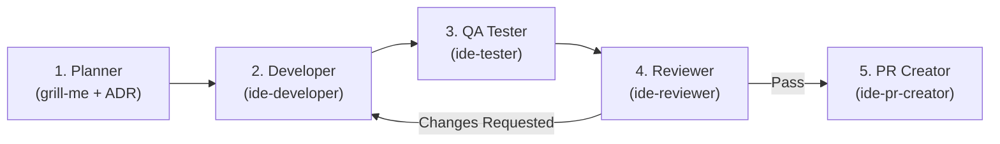

# 5-Agent Development Pipeline

Every milestone (Jalon), feature, and bug fix in this repository **must** be executed sequentially through the mandatory **5-Agent Development Pipeline**.

---

## Pipeline Overview

---

## Agent Responsibilities & Quality Gates

### Agent 1 — Planner (`grill-me` + Plan / ADR)

- **Role**: System architect and product specification owner.
- **Inputs**: User request, `PLAN.md`, `CONTEXT.md`, `docs/adr/`.
- **Responsibilities**:
  1. Stress-test requirements and resolve design ambiguities before any code is written.
  2. Update `CONTEXT.md` (ubiquitous language) and author/update `docs/adr/*.md` when architectural decisions are made.
  3. Create or switch to a dedicated feature branch (`feat/...`, `fix/...`, `chore/...`).
  4. Hand off an unambiguous, file-level specification to Agent 2 (`ide-developer`).

### Agent 2 — Developer (`ide-developer`)

- **Role**: Production code engineer.
- **Inputs**: Planner specification, `AGENTS.md`, `docs/agents/coding-guidelines.md`, `docs/agents/architecture.md`.
- **Responsibilities**:
  1. Strictly enforce the **3-Layer Clean Architecture**:
     - Layer 1 (`src/providers/`, `src/services/`, `src/types/`): Pure TypeScript with **zero Vue imports**.
     - Layer 2 (`src/composables/`): Reactive Vue 3 composables bridging Layer 1 services.
     - Layer 3 (`src/components/`, `src/entrypoints/`): Vue 3 UI components and WXT entrypoints.
  2. Enforce strict TypeScript typing (zero `any`, zero forced `as` assertions), `@/` path aliases, `import type` syntax, semantic CSS variables, and multi-locale i18n keys.
  3. Run post-development verification before finishing:
     - `pnpm lint:fix`
     - `pnpm lint:css:fix`
     - `pnpm format`
     - `pnpm compile`

### Agent 3 — QA Tester (`ide-tester`)

- **Role**: Verification and test suite engineer.
- **Inputs**: Production implementation, `docs/agents/testing.md`.
- **Responsibilities**:
  1. Write comprehensive **Unit Tests** (`tests/providers/`, `tests/services/`, `tests/types/`, `tests/composables/`), **Integration Tests** (`tests/entrypoints/`), and **Playwright E2E Tests** (`e2e/`).
  2. Follow Vitest mock hygiene (`clearMocks: true` globally, never call `vi.clearAllMocks()` manually, use `mockBrowser` in `tests/setup.ts`, prefix fire-and-forget calls with `void`, use `vi.waitFor`).
  3. Execute and verify all test gates:
     - `pnpm test`
     - `pnpm compile`
     - `pnpm test:e2e`

### Agent 4 — Reviewer (`ide-reviewer`)

- **Role**: Independent code quality and architecture auditor.
- **Inputs**: Git diff against base branch, `AGENTS.md`, `docs/agents/*.md`, `CONTEXT.md`, `docs/adr/*.md`.
- **Responsibilities**:
  1. Audit the entire diff for:
     - 3-Layer Clean Architecture boundaries (zero Vue imports in Layer 1).
     - Strict TypeScript typing (zero `any`, zero `as` casts).
     - DRY, KISS, absence of dead code or test-specific production branches.
     - Token security invariants (no secrets in `storage.sync` or exported payloads).
  2. Run the full validation gate:
     - `pnpm lint`
     - `pnpm lint:css`
     - `pnpm format:check`
     - `pnpm compile`
     - `pnpm test`
     - `pnpm metadata:check`
     - `pnpm build`
  3. If any issue is found, send actionable feedback back to Agent 2 (`ide-developer`) and Agent 3 (`ide-tester`) and re-verify until 100% clean.

### Agent 5 — PR Creator (`ide-pr-creator`)

- **Role**: Release & Git workflow publisher.
- **Inputs**: Verified branch passing all Reviewer gates.
- **Responsibilities**:
  1. Verify `git status` and ensure no untracked temporary artifacts remain.
  2. Stage changes and create an atomic Conventional Commit in English (`feat: ...`, `fix: ...`, `chore: ...`).
  3. Push the feature branch to `origin` and open a comprehensive Pull Request via `gh pr create`.
